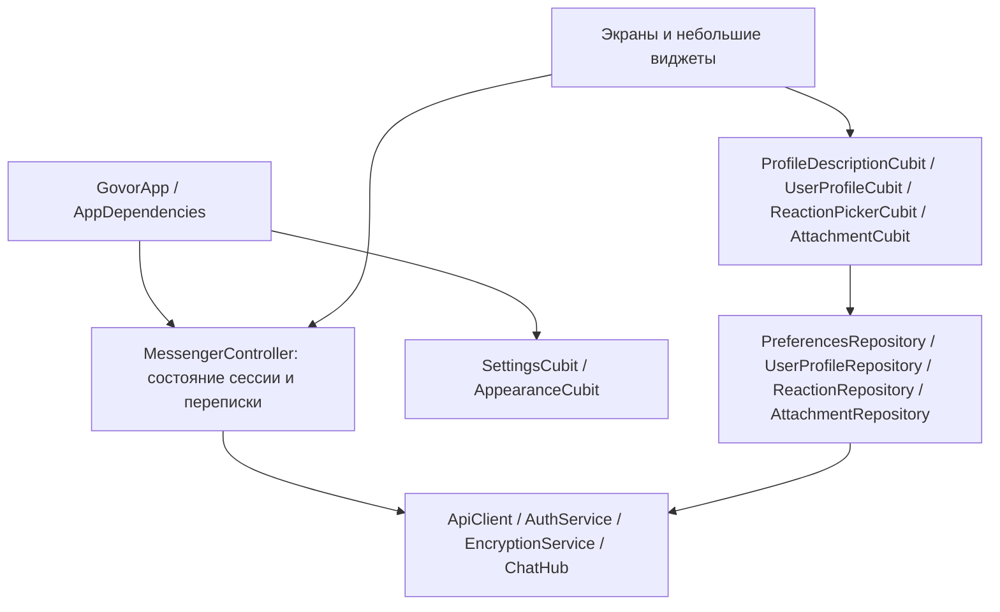

# Архитектура Flutter-клиента

Изменения от 31 октября 2026 года. Рабочая версия SDK: Flutter 3.38.6 / Dart 3.10.7; версии зависимостей фиксирует pubspec.lock.

## Слои и зависимости



AppDependencies — точка сборки зависимостей. Фабрики API, аутентификации, E2EE, хабов и репозиториев передаются через конструктор; хранилище, метаданные пакета и WallpaperRepository тоже заменяемы. GovorApp предоставляет зависимости дереву через RepositoryProvider. Глобального service locator нет. В тестах используются MemorySecretStore, MockClient, управляемые Future и реализации интерфейсов репозиториев.

MessengerController сохраняет роль MVVM-координатора с ChangeNotifier для жизненного цикла сессии, криптографического протокола, истории, отправки и черновиков. Новые отдельные обязанности используют Cubit из flutter_bloc. Это не объявляется полным переводом всей старой модели на BLoC: часть состояния координатора пока изменяемая, а ряд контрактов групп/реакций представлен Json. Следующий рефакторинг этих частей можно делать отдельно от уже проверенной криптографии.

В UI нет прямых HTTP-запросов, вызовов SignalR или команд криптографического сервиса. Экран передаёт намерение координатору/Cubit и отображает состояние. Управление видеопроигрывателем и временем жизни его временного источника остаётся в виджете, поскольку зависит от его появления на экране.

## Состояние по функциям

| Компонент | Ответственность |
| --- | --- |
| SettingsCubit | Язык, размер основного текста, предпросмотр размера, выбор раздела настроек, восстановление предпочтений, ошибки записи |
| AppearanceCubit | Обои, тема, пользовательские фоны; последовательная запись без потери параллельных изменений |
| ProfileDescriptionCubit | Debounce, сохранение по потере фокуса, сериализация правок, повтор, сохранение черновика при ошибке |
| UserProfileCubit | Загрузка профиля и отношений; только допустимые команды дружбы, защита от повторной заявки |
| ReactionPickerCubit | Загрузка паков, выбор/поиск, компактный и полный выбор, отдельные ошибки загрузки и изменения реакции |
| AttachmentCubit | Загрузка расшифрованных байтов, проверка формата/размеров изображения, повтор после ошибки |

Экраны профиля, защиты, паков, контактов и общие элементы разделены на файлы. MessageBubble отделён от навигации и редактора сообщения. Публичные импорты feature_pages.dart сохранены для совместимости.

## Локализация

lib/l10n/app_ru.arb и app_en.arb содержат тексты интерфейса и параметры. Flutter gen-l10n создаёт типизированный AppLocalizations в lib/l10n/generated. context.l10n используется в интерфейсе; строки не ищутся по исходному русскому тексту во время работы. Язык меняется без перезапуска, до входа определяется системой, а в профиле выбирается вручную и сохраняется отдельно от аккаунта. Доступны русский, английский и системный язык. Тест сверяет ключи и параметры каталогов.

Размер основного текста (12–24, стандартный 14) задаётся в SettingsCubit. Перетаскивание обновляет предпросмотр без записи на диск; onChangeEnd сохраняет значение, сбой возвращает последний сохранённый размер. LocalPreferencesRepository сериализует read-modify-write, сохраняя язык и размер при одновременных изменениях. В MaterialApp.builder единый GovorTextScaler масштабирует все стили, включая явно заданные размеры заголовков, подписей, меню, сообщений и редактора. Он передаёт размер с пользовательским коэффициентом системному TextScaler, сохраняя нелинейное масштабирование доступности. Базовые размеры остаются неизменными, повторное масштабирование исключено.

Чтобы добавить язык: создать app_<locale>.arb с теми же ключами, перевести значения, добавить язык в SettingsCubit/PreferencesRepository и селекторы, выполнить flutter gen-l10n и тесты. Тексты пользователей, имена паков и ответы/ошибки старого протокола не являются словарём интерфейса. Часть диагностик сервисов пока остаётся русской.

## Вложения и Markdown

EncryptedAttachmentRepository шифрует до загрузки. Оригинальные имя, MIME и ключ остаются внутри E2EE-конверта. Авторизованное скачивание и проверка AES-GCM предшествуют показу. Кэш находится в памяти сессии, ограничен 38 000 000 байт и учитывает одновременно mediaId и ключ; одинаковые загрузки объединяются. Байты кэша доступны только для чтения. Выход/смена сессии очищают кэш и запрещают выдачу запоздалых результатов.

PNG/JPEG/WebP/GIF показываются миниатюрами, несколько файлов образуют сетку. Полноэкранный просмотр позволяет масштабировать фото, переключать файлы и сохранять их. Видео MP4, WebM, MOV и Matroska используют media_kit: в переписке показывается первый кадр с кнопкой открытия; просмотр имеет управление воспроизведением. Старые видео с MIME octet-stream распознаются по подсказке расширения, затем обязательно проверяется содержимое. Поддержка конкретных кодеков зависит от платформы; остальные файлы можно сохранить.

Native-проигрыватель получает отдельный временный файл, удаляемый после освобождения Player. В web создаётся Blob URL, который отзывается при закрытии. Это временный источник воспроизведения, а не постоянный кэш. При аварийном завершении процесса системная временная папка может сохранить файл; гарантии физического стирания памяти/диска нет. Нативному проигрывателю разрешены локальные протоколы file/data/crypto.

GovorMarkdown используется в сообщениях, профилях людей, описаниях групп и предпросмотре собственного описания. Поддерживаются базовое форматирование, заголовки, списки, цитаты, ссылки, таблицы и блоки кода. Исходный Markdown сохраняется и шифруется без преобразования в HTML. Встроенный HTML не исполняется. Markdown-изображения/GIF показываются в потоке текста; отдельные ссылки на изображения от старых клиентов также распознаются, кроме блоков кода. RemoteImageRepository использует отдельный HTTP-клиент без Bearer token, проверяет перенаправления, лимит 10 MiB, сигнатуру формата, размеры изображения и срок запроса. Это внешние запросы к хосту изображения; реальные вложения проходят отдельный E2EE-путь. Альбомы с зазорами 2 px находятся перед подписью, а редактор показывает миниатюры вложений. Ссылки открываются по нажатию, только http/https. file/data/javascript и ссылки с логином/паролем не запускаются.

## Ответы, пересылки и benefits

ReplyPreview читает оригинал вне страницы истории через GET /api/messages/{id}, проверяет совпадение ID/чата/типа и расшифровывает обычным E2EE-путём. Отсутствие/недоступность оригинала (404) показывается как удалённое сообщение; сетевой сбой позволяет повтор.

Пересылка использует отдельный Send для каждого сообщения и forwardedFromMessageId. Имена автора и дата происхождения принимаются только из ответа сервера; это не подпись автора под пересланным текстом. Файлы расшифровываются и заново загружаются с новыми ключами. PendingSend сохраняет происхождение, новый ID, конверт и файлы для идентичного повтора. Черновик и вложения чата назначения сохраняются. Ошибка загрузки файла не отправляет частичную пересылку.

UserBenefitsCache объединяет профильные HTTP-снимки, ответы записи и UserBenefitsUpdated по монотонной revision; равные и старые версии игнорируются. Наблюдаемые профили перечитываются после reconnect. Выход/смена аккаунта очищают состояние; результаты старой сессии отбрасываются. ProfileTag ограничивает поля, размеры, цвета и шрифты по API. Текст тега выводится как plain text, удалённые шрифты не загружаются. Официальный знак определяется isGovorPlus, доступ к редактору — canCustomizeProfileTag. UserProfileCubit отдельно проверяет право снять собственную блокировку; сервер остаётся источником авторизации всех операций.

## Проверки

- Unit: состояния Cubit, ошибки хранения, гонки загрузки/выбора, сериализация сохранений, отношения дружбы, версии/снятие реакций, репозитории, пагинация, шифрование и очистка медиа.
- Widget: отправка/поиск/черновики, размеры окна, правый раздел настроек, язык, контекстное меню мышью, два способа снятия реакции, галерея/масштабирование, Markdown на узком экране с крупным текстом, кнопки профиля для разных статусов.
- Сохранены проверки .NET interoperability, SRP, E2EE, архива, refresh/logout и реального локального SignalR/WebSocket.
- test/preview_test.dart сохраняет снимки в build/previews; они проверяются визуально.
- tools/media_smoke.dart проверяет реальное декодирование локального видео libmpv и удаление временного файла. Обычные unit/widget-тесты не требуют нативного проигрывателя или сервера.

```sh
flutter pub get --enforce-lockfile
flutter gen-l10n
dart format --output=none --set-exit-if-changed lib test tools/media_smoke.dart
flutter analyze
flutter test --coverage --reporter expanded
```

Покрытие строк находится в coverage/lcov.info. Это измерение выполненных строк, а не гарантия отсутствия дефектов и не подтверждение работы всех платформ. Для production-аккаунта, Firebase, Android/iOS/Linux и сетевых сбоев реального сервера нужны отдельные интеграционные прогоны.

Основа решений: [рекомендации Flutter по архитектуре](https://docs.flutter.dev/app-architecture/recommendations), [локализация Flutter](https://docs.flutter.dev/ui/internationalization), [flutter_bloc](https://pub.dev/packages/flutter_bloc), [media_kit](https://pub.dev/packages/media_kit), [Flutter Markdown Plus](https://pub.dev/packages/flutter_markdown_plus).

### Аватарки и параметры приглашений

PreviewAvatar используется во всех списках, заголовках и профилях, включая настройки. AvatarPreviewDialog получает изображение из авторизованного кэша по ID (для участника сначала читает профиль), ограничивает файл 4 МБ, проверяет тип и размеры, декодирует ограниченное превью и сохраняет исходные байты только по кнопке. Расширение определяется сигнатурой, имя пользователя не становится именем файла. При смене сессии изображение скрывается, скачивание блокируется; декодированный кэш окна освобождается при закрытии. Ошибки загрузки и сохранения допускают повтор.

Владелец группы меняет/удаляет аватарку через отдельные POST/DELETE /api/groups/{id}/avatar. Multipart использует поле file; до отправки проверяются PNG/JPEG/WebP, 2 МиБ и 2048 px. Сервер повторно проверяет права и статичность. GroupInvitationOptions хранит срок 1–365 дней, лимит вступлений 0–1 000 000 (0 без лимита), описание до 500 символов. GroupInvitationDialog отвечает за форму и сохранение введённого при ошибке; создание выполняется переданным callback, повторная отправка блокируется. Успешный DTO добавляется в список без повторного POST при ошибке перечитывания.

### Диагностика отказа при отправке

Получение и расшифровка сообщения не подтверждают, что устройство может отправить своё. При отправке сервер дополнительно проверяет время подписанного конверта (допуск ±5 минут), действующую сессию и ключ подписи, список устройств и контекст чата/цитаты/вложений. Стабильная блокировка в личном чате действует в обе стороны.

HubCommandFailure сохраняет HTTP-подобный статус SignalR и сопоставляет известные ошибки с безопасными подсказками. Серверные коды E2EE_TIMESTAMP_OUT_OF_RANGE, E2EE_SIGNING_DEVICE_REJECTED и E2EE_DEVICES_CHANGED различают расхождение времени, отклонённое устройство и изменение состава получателей. Для совместимости клиент также распознаёт прежний общий отказ проверки времени или маршрута. Неизвестный текст ответа не выводится пользователю.

Подтверждённый отказ при первой попытке, если команда отклонена до сохранения, освобождает черновик для новой отправки со свежим конвертом. Текст, цитата и вложения сохраняются. Если подтверждение могло потеряться, прежний ID и конверт сохраняются; следующий отказ не превращает более раннюю неопределённую попытку в подтверждённый отказ. Успешная запись находится по событию или при перечитывании истории. Проверки E2EE и допустимое окно времени остаются прежними.
